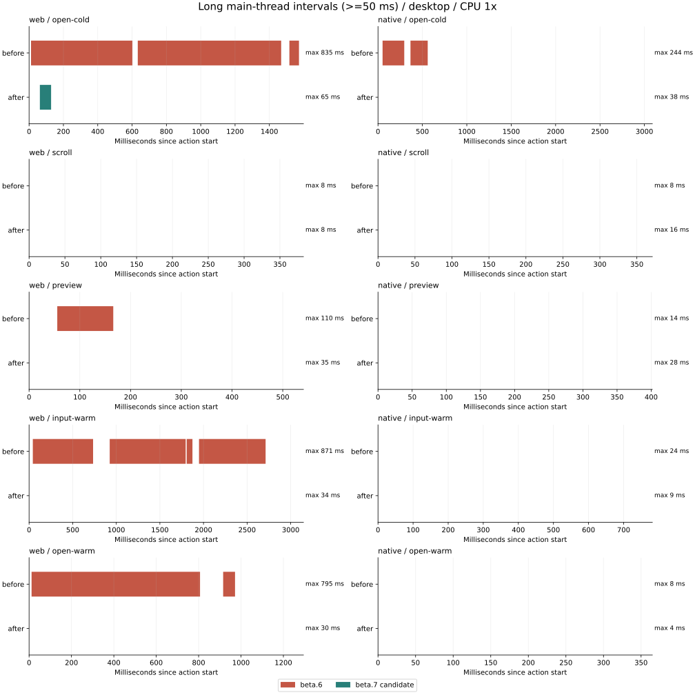
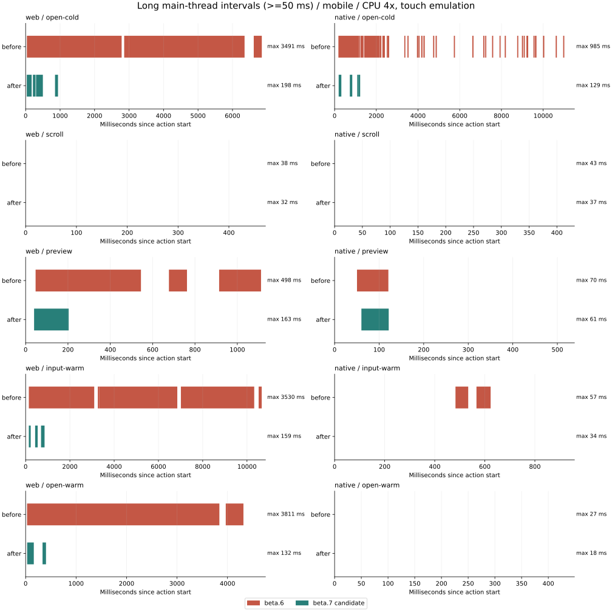

# 长释义主线程热点（HAM-195 第二轮）

本页为 dev + tracing 的热点诊断，不能当作 production 基线。生产构建、不挂 tracing 的三次对照及 native 读取器重复校验修复见[第三轮报告](text-resolution-production.md)。

上一轮的受控候选队列基准没有覆盖真实词库的完整搜索输入链。本轮从仍在运行的 19502（Demo）与 19501（native WebView 浏览器壳、官方 beta.6）直接录制“行”的冷打开、滚动、点词小窗、输入与热打开；保留 Chrome trace 和 CPU profile，按原子操作定位后再优化。

已确认的问题与实现：

- `suggestChinese` 每次遍历全部 617,747 条源词头。加载快照时建立首 Unicode 字符分组，查询只扫描对应组，保留精确词优先、长度排序、跨包稳定顺序和去重。手工构造的可变 Map 词库继续走实时扫描。
- Demo 每次输入重新构建唯一词头 Set。统计改为仅随词库变化；静态配置面板与纠错列表避免无关重渲染。
- Demo 的词形补充数组和加载回调每次渲染都变，连带重建 provider/session。稳定这些依赖；浏览器回归验证输入其他查询时，已解析的点词按钮保持同一个 DOM 节点，纠错删除与恢复仍可更新。
- 离线资源的双 SHA-256、gzip 解压与大索引 UTF-8 解码同步执行。共享层每个资源 store 复用一个内联 Worker，保留全部完整性校验；没有 Worker、构造失败或启动失败时回退到同一套同步校验。释放 store 会终止 Worker 并拒绝在途请求。读取器的输入 buffer 始终复制后再 transfer。
- 同一缓存分片的文本解码与按行切分原先在每次候选命中时重复执行。按原始分片对象用 WeakMap 缓存行，随 LRU 的原始分片生命期回收；清缓存与释放时一并重置。12 MiB 上限仍指原始分片字节，额外的行字符串与索引不属于该数值的堆内存上限。

公开 API 与 `definition-word-preview` 契约不变。native 只升级依赖和补充实际 Worker 接线回归。

## 单次原子操作排序

以下按优化前的单次最大值排序，移动模拟、真实数据、每项 7 次同步调用；并列保留原始样本，不把累计采样时间当成单次成本。最大中文索引压缩为 1,925,954 bytes，解压后为 5,535,203 bytes。

| 操作                                 | 优化前最大 / 中位数（ms） | 优化后处理                                                          |
| ------------------------------------ | ------------------------: | ------------------------------------------------------------------- |
| 原始索引 SHA-256                     |             414.7 / 328.7 | 在 Worker 校验；纯计算基准仍为 351.5 / 333.2 ms，并非消除了计算     |
| 四词库唯一词头 Set                   |             336.4 / 196.1 | 只在词库变化时统计，输入路径不再调用；独立调用仍为 252.3 / 207.3 ms |
| 索引 gzip 解压                       |             231.7 / 207.4 | 在 Worker 执行，纯计算基准为 295.2 / 207.0 ms                       |
| 压缩索引 SHA-256                     |             163.9 / 123.1 | 在 Worker 校验，纯计算基准为 161.3 / 120.2 ms                       |
| 中文前缀候选                         |               92.8 / 38.3 | 首字符索引后为 **4.1 / 1.3 ms**                                     |
| 索引 UTF-8 解码                      |               70.5 / 65.8 | 在 Worker 执行，纯计算基准为 95.7 / 73.5 ms                         |
| 中文最长匹配（整篇“行”、已缓存查表） |                13.3 / 4.6 | 16.6 / 3.0 ms，保留原算法                                           |
| 提取文本 token                       |                 6.3 / 0.1 | 7.8 / 0.5 ms，保留原算法                                            |
| 单词头精确查询                       |                1.2 / <0.1 | 0.5 / <0.1 ms                                                       |
| `went` 词形来源查表                  |                0.1 / <0.1 | 0.5 / <0.1 ms，未成为热点                                           |

原始逐次值见 [优化前](performance/text-hotspots-atoms-before.json) / [优化后](performance/text-hotspots-atoms-after.json)。同一算法独立调用的波动不用于声称优化收益；Worker 中的计算成本与主线程阻塞成本分别报告。

## 长任务瀑布

每格为该动作窗口内最长 renderer 主线程区间的毫秒数，优化前 → 后。冷打开指新页面内第一次搜索，Demo 四个中文包已加载；不包含启用整个大词库时的模块解析和快照初始化。

| 端 / 动作               |  桌面 CPU 1× | 移动模拟 CPU 4× |
| ----------------------- | -----------: | --------------: |
| Web 冷打开“行”          | 835.4 → 65.5 |  3491.1 → 197.5 |
| Web 滚动到底再回首段    |    8.1 → 8.4 |     37.6 → 32.0 |
| Web 点词小窗            | 110.4 → 35.4 |   497.7 → 163.5 |
| Web 输入“行走”          | 871.2 → 34.0 |  3530.1 → 158.7 |
| Web 热打开“行”          | 794.9 → 30.3 |  3810.6 → 131.5 |
| native 冷打开“行”       | 244.2 → 37.8 |   985.3 → 128.7 |
| native 滚动到底再回首段 |   8.5 → 16.1 |     42.6 → 37.3 |
| native 点词小窗         |  13.8 → 28.1 |     70.4 → 61.3 |
| native 输入“行走”       |   23.6 → 9.2 |     56.6 → 34.5 |
| native 热打开“行”       |    7.8 → 3.9 |     27.1 → 17.9 |





[桌面原始区间](performance/text-hotspots-desktop.json) / [移动模拟原始区间](performance/text-hotspots-mobile.json) 同时保留 Long Tasks API 的交叉核对结果。阈值以下区间的几毫秒波动不视作回归或收益。最明显的改善来自移除重复扫描、provider 重建与主线程资源验证，未证明所有动作都不再掉帧：移动模拟下 Web 渲染仍有 132～198 ms 的区间，native 预览仍有 61 ms 区间。应继续以真机和具体复现动作验收，不能把模拟结果描述为零长任务。

本组优化后 native 使用 `9b5e286` 构建的本地 beta.7 tarball，不冒充官方 npm 安装。测量时 beta.7 尚未公开可安装；随后发布阻塞解除，2026-11-10（Asia/Shanghai）已从官方 npm 和全新独立缓存完成正常安装及不可变安装，两个 workspace 的包、manifest、运行时均为 beta.7，native `yarn check`（53+156 项）和桌面/移动离线 E2E 4/4 通过，WebView HTML 为 9,834,257 bytes。[native #18](https://github.com/HamsterNote/dictionary-native/pull/18) 已补真实正式锁文件。官方包回归不改变上述性能数据的测量来源；iOS/Android 真机仍待验收。

测量口径：

- 桌面 1440×900、CPU 1×；移动为 390×844、触摸与主线程 CPU 4× 的 Chromium 模拟，不能替代 iOS/Android 真机。Worker 不按主线程的 4× 节流倍数运行。
- 每个动作使用单独的 trace 与 CPU profile；计算 renderer 主线程 `toplevel` 区间并合并重叠区间，包括独立的 `BlinkScheduler_PerformMicrotaskCheckpoint`。只筛选 `RunTask` 会漏掉异步资源读取后进行的同步计算。
- 同时用 Long Tasks API 交叉核对；瀑布展示 ≥50 ms 的区间。操作窗口含自动化等待，不能把总窗口时间当作纯计算耗时。
- 原子基准在浏览器内使用真实四个词库和最大中文索引，连续同步调用 7 次，保留每次值、最大值和中位数。它区分单次计算成本与整段采样累计值；优化后在 Worker 上运行的纯哈希/解压不会因此变成更便宜的算法。

复现：

```bash
git worktree add --detach ../ham195-hotspot-before d884079
ln -s ../dictionary/node_modules ../ham195-hotspot-before/node_modules
node scripts/profile_dictionary_hotspots.mjs before-final
HOTSPOT_CPU=1 node scripts/profile_dictionary_hotspots.mjs before-final-desktop
HOTSPOT_WEB_ROOT="$PWD" HOTSPOT_NATIVE_URL=http://127.0.0.1:18957 node scripts/profile_dictionary_hotspots.mjs after-final
HOTSPOT_CPU=1 HOTSPOT_WEB_ROOT="$PWD" HOTSPOT_NATIVE_URL=http://127.0.0.1:18957 node scripts/profile_dictionary_hotspots.mjs after-final-desktop
node scripts/benchmark_dictionary_atoms.mjs
node scripts/collect_dictionary_hotspot_report.mjs
python3 scripts/plot_dictionary_hotspots.py
```

优化后 native 地址必须指向安装本轮构建包的隔离检出；原验收服务保持 beta.6 作为对照。绘图需要 matplotlib。trace/profile 位于 `artifacts/`，摘要、单次样本与瀑布图保存在 `docs/performance/`。

验证包含候选稳定排序/去重/多字节汉字、31 个离线查询对照、100 次查询缓存上限、Worker 复用/并发/校验失败/释放/三种降级，以及桌面和移动离线 E2E 的实际 Worker 存活断言。全仓原有 50 个格式问题保持不修。
