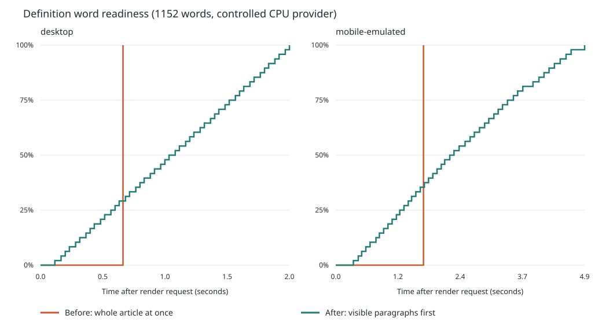

# 释义点词性能对比（HAM-195）

2026-11-09，同一 Linux / Node 24.15.0 / Chromium 主机、Vite 开发构建；优化前 `791019a57d34bc8e2ce5fcfd4f58c8a4501b5ba8`，优化后为本 PR。每端各一次冷页面运行，前后串行执行。共享主机存在其他任务，单次测量不能视为稳定分位数或真机性能承诺。

受控长释义：48 段 × 24 个唯一英文候选 = 1152 次查询；每次 provider 固定消耗 0.35 ms 同步 CPU 后兑现 promise，不使用网络。桌面 1440×900、CPU 1×；移动 390×844、触摸、CPU 4× 降速模拟。中文最长匹配、变形和真实离线资源另由现有固定对照及预览 E2E 验证。

| 端              | 版本   | 全部就绪 ms | 首个可见段落就绪 ms | 最长主线程任务 ms | ≥50 ms 长任务数 | 总阻塞时间 ms | 最大查询并发 |
| --------------- | ------ | ----------: | ------------------: | ----------------: | --------------: | ------------: | -----------: |
| desktop         | 优化前 |       662.3 |               662.3 |             536.1 |               2 |         509.0 |         1152 |
| desktop         | 优化后 |      1998.7 |               115.1 |              60.7 |               1 |          10.0 |            1 |
| mobile-emulated | 优化前 |      1725.5 |              1725.5 |            1167.2 |               4 |        1584.0 |         1152 |
| mobile-emulated | 优化后 |      4893.9 |               347.2 |             229.8 |               1 |         179.0 |            1 |

最长任务由 Chrome tracing 的 renderer 主线程 RunTask 获取，包含首次渲染触发任务；长任务由 PerformanceObserver 统计与测量窗口重叠的 ≥50 ms 任务，总阻塞为 Σ max(duration − 50, 0)。两种观测可能存在取整差异。曲线通过逐帧读取可点词 DOM 数量获取；基准自身的布局测量开销也包含在运行中。

| 端              | 版本   | 25% 可点 ms | 50% 可点 ms | 75% 可点 ms | 100% 可点 ms |
| --------------- | ------ | ----------: | ----------: | ----------: | -----------: |
| desktop         | 优化前 |       662.3 |       662.3 |       662.3 |        662.3 |
| desktop         | 优化后 |       565.2 |      1031.9 |      1515.2 |       1998.7 |
| mobile-emulated | 优化前 |      1725.5 |      1725.5 |      1725.5 |       1725.5 |
| mobile-emulated | 优化后 |      1259.0 |      2242.0 |      3377.0 |       4893.9 |

以更晚的全篇就绪换取更早的可见段落交互和更短的主线程阻塞。此次样本中，桌面最长任务减少 88.7%，首个可见段落就绪提前 82.6%；移动模拟最长任务减少 80.3%，首个可见段落就绪提前 79.9%。长任务仍可能来自首次 React 渲染或不可分割的单次 provider 调用，4 ms 切片不是同步代码的硬上限。

原始逐帧数据：[优化前](performance/text-resolution-before.json)、[优化后](performance/text-resolution-after.json)。复测命令和调度边界见 [实现说明](text-resolution-scheduling.md)。iOS/Android 真机尚未验证。

验证：新增队列测试、桌面/移动尺寸的调度浏览器回归、现有中文/英文文本候选对照和预览 E2E 通过；全量功能测试链通过并完成库构建。`yarn run check` 在主分支已有的 50 个格式问题处停止；全仓 lint 有 4 个既有问题（系统音标规则相关文件），本次代码定向 lint、格式与 TypeScript 检查通过。未通过扩大范围改写历史规格或数据格式来掩盖这些缺口。
